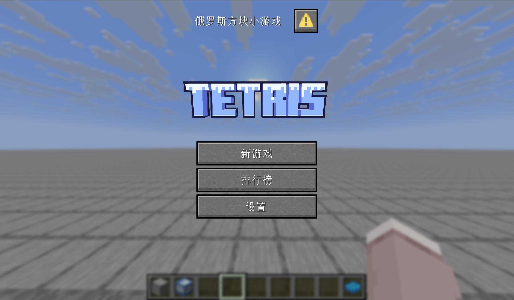
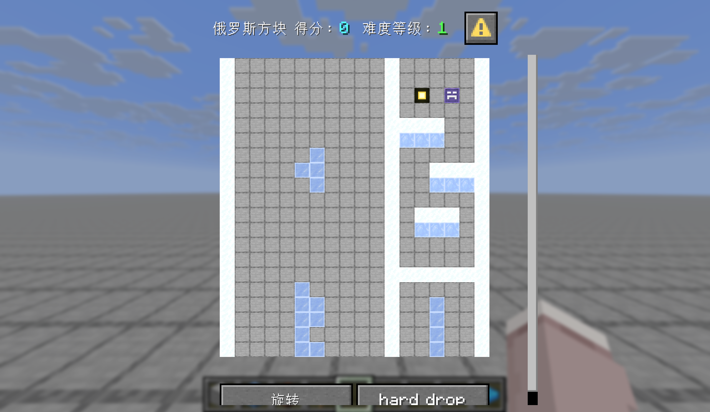
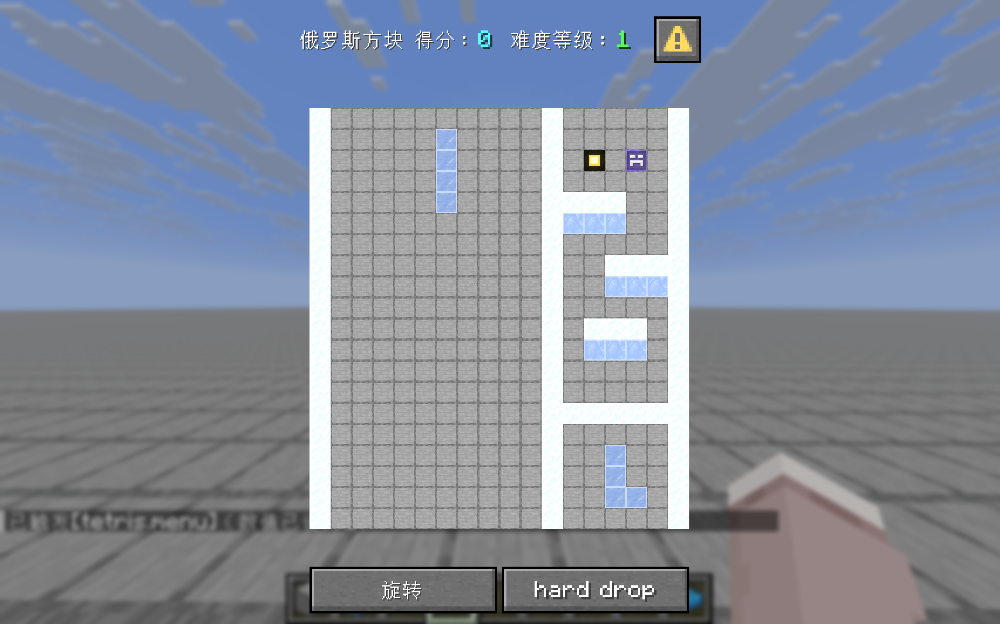
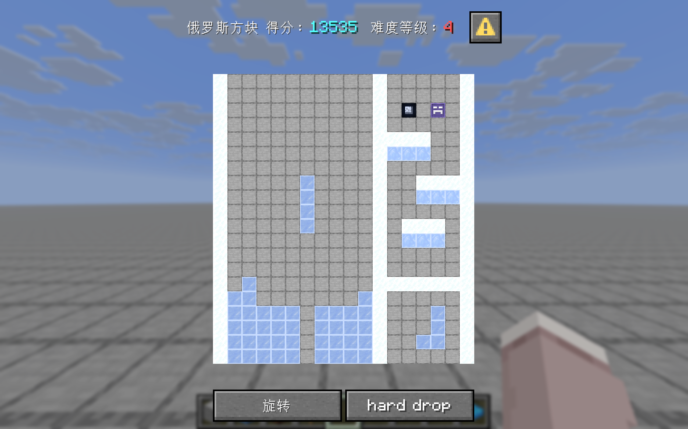
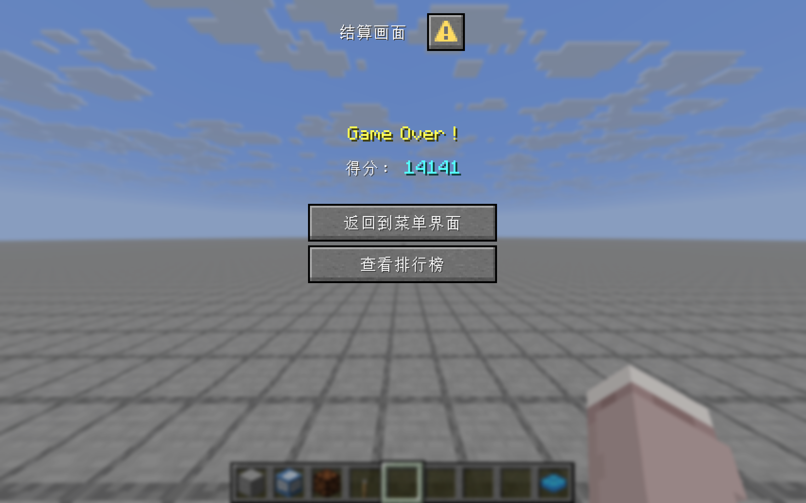

# 基于Minecraft原版数据包与资源包制作的经典2D游戏——俄罗斯方块
## 适用版本
Minecraft **26.3**

## 安装
**引自中文Minecraft Wiki：**
### 资源包
>**全局资源包**  
>全局资源包需要放置在.minecraft内的resourcepacks文件夹，每个全局资源包都必须是一个子文件夹或一个.zip文件，其他文件格式会被忽略。全局资源包可以被禁用、启用或者调整位置。资源包的显示名称即为该文件夹或.zip文件的名称（含扩展名），可使用格式化代码。

>**世界指定资源包**  
>资源包可以与世界捆绑在一起。将资源包重命名为resources.zip，再将这个文件放入<存档根目录>/resourcepacks中，这个资源包就会成为世界指定资源包。当玩家进入这个世界时，这个资源包将作为最上层资源包被加载，且无法被禁用或调整位置。其名称将显示为“世界指定资源包”。
### 数据包
>数据包是可被添加到<存档根目录>/datapacks/目录下的文件夹或.zip压缩包。

对于资源包，玩家可以选择两种方式，全局安装或者世界指定安装，后者需要玩家对资源包进行**重命名**，**并在存档根目录下创建名为resourcepacks的文件夹**，再将资源包放置在该文件夹内，示例路径：.minecraft\versions\26.3\saves\俄罗斯方块\resourcepacks\。  
对于数据包，正常安装即可。

## 游玩
安装完成后，按**G**键可快捷唤出游戏的主菜单界面，亦可在聊天栏执行命令`/dialog show @s tetris:main_window`，点击**新游戏**开始游玩。

>游戏规则send_command_feedback控制玩家执行命令的返回信息是否在聊天框中显示，同时影响命令方块是否保存命令输出文本。  

因此你可以执行`/gamerule send_command_feedback false`来关闭聊天栏频繁出现的命令反馈。  
此外，游戏画面显示可能并不适应你的屏幕，这十分影响游戏体验，需要**在视频设置中调整分辨率或界面尺寸**。如下图所示，右侧出现滑条，下方按钮显示不完整。  

## 玩法介绍 

- 方块操控  
左移、右移、下移按钮位于画面右侧，也就是那三个覆雪冰块。  
点击`左移`按钮，方块将向左平移一格  
点击`右移`按钮，方块将向右平移一格  
点击`下移`按钮，方块将随机加速下落3~5格（含3,5）  
点击`旋转`按钮，方块将顺时针旋转90°  
点击`hard drop`按钮，方块将直接降落至底部边界或下方方块表面
- 下一个方块预览  
右下角出现的方块即为下一个降落的方块
- 得分机制  
消除1行加100分  
消除2行加200分  
消除3行加300分  
消除4行加600分  
点击`下移`按钮得1分  
点击`hard drop`按钮，游戏将会计算方块下落前后的高度差，以高度差的值为所加分数  
- 难度等级  
难度等级影响方块自然下落一格所需时间，难度等级（lv）越高，所需时间（t，单位为游戏刻）越短  
难度等级由得分（s）区间决定：  
当s大于等于0小于3000时，lv = 1，t = 20   
当s大于等于3000小于6000时，lv = 2，t = 16  
当s大于等于6000小于12000时，lv = 3，t = 12  
当s大于等于12000时，lv = 4，t = 10 
 
- 游戏失败判定  
方块降落，并在游戏完成行消除判定后，若其最高点高于上边界，则游戏结束
- 暂停与结束游戏  
点击暂停图标，游戏暂停，图标变化，再次点击，游戏继续  
点击结束图标，游戏结束，并跳转至分数结算画面
