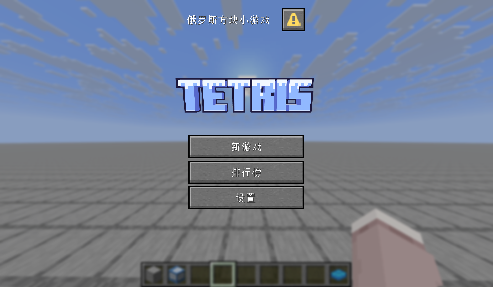
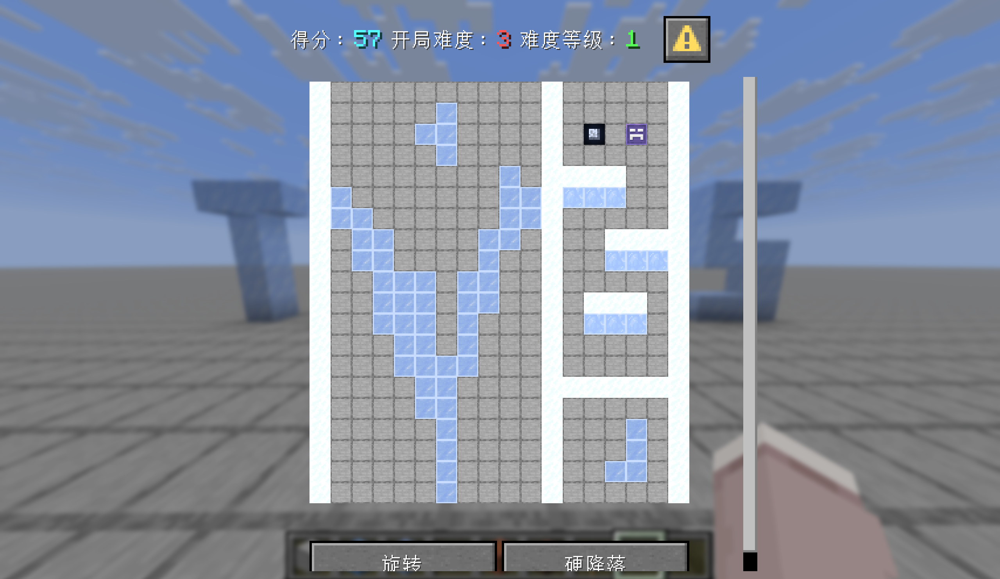
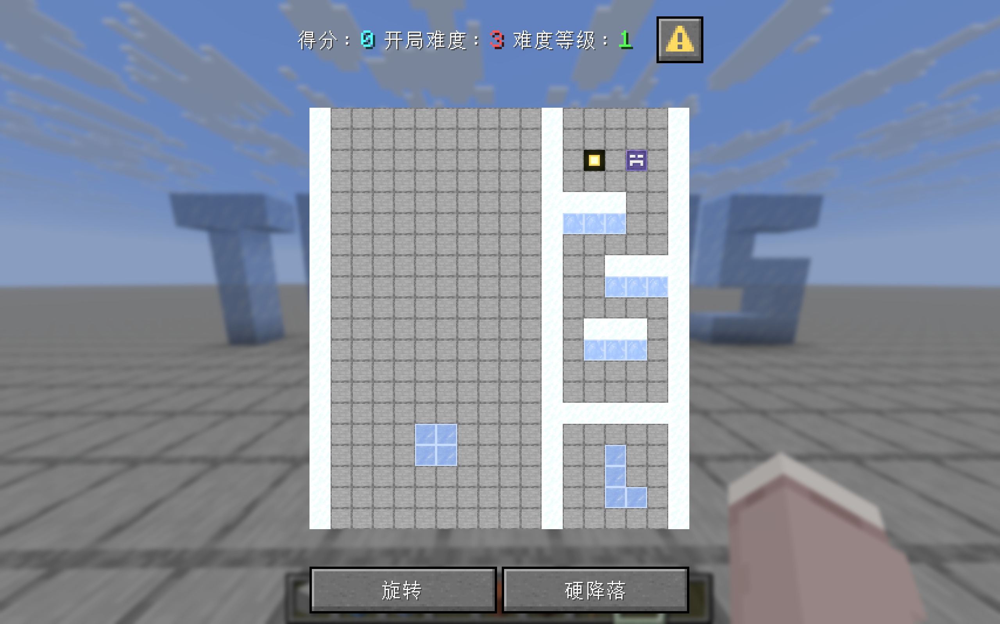
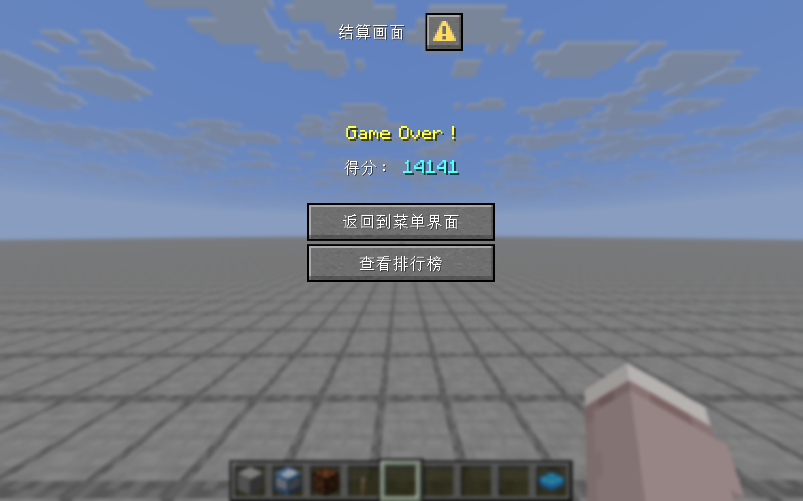
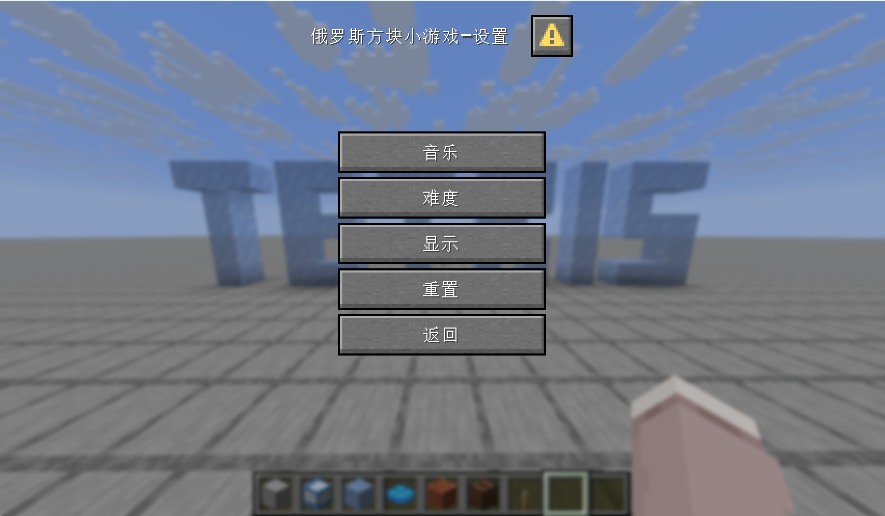
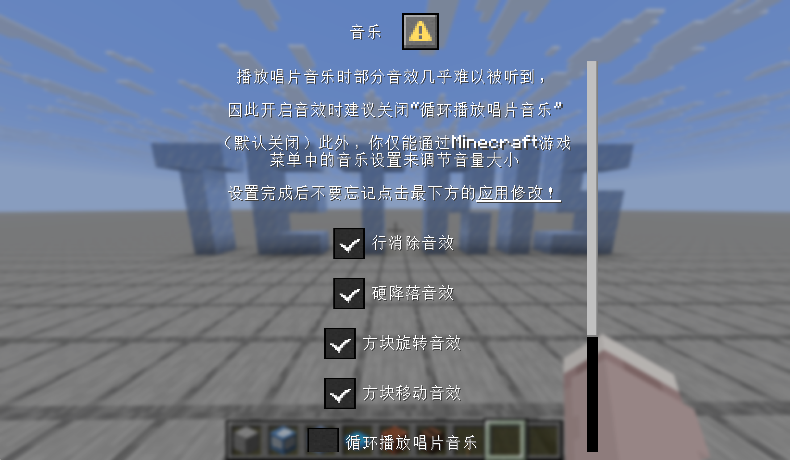
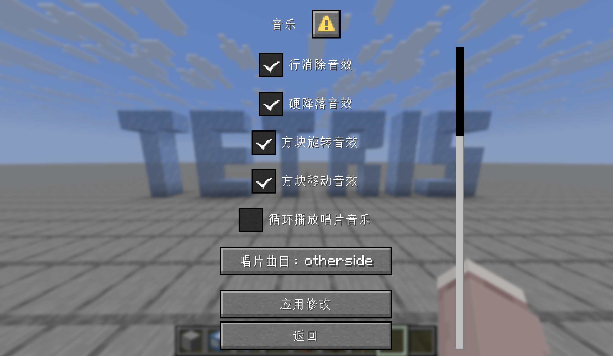
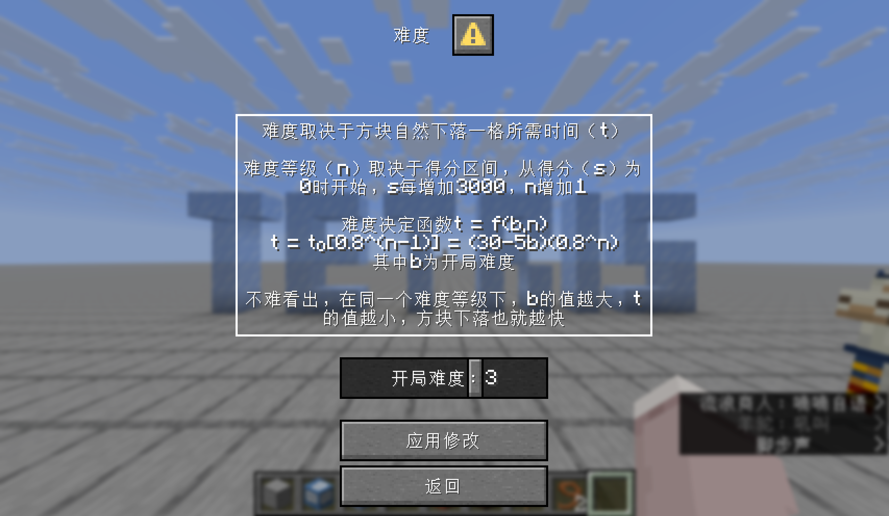
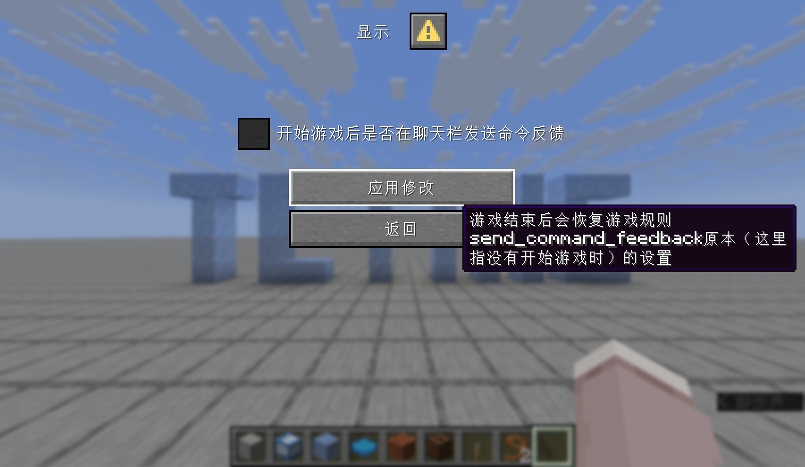
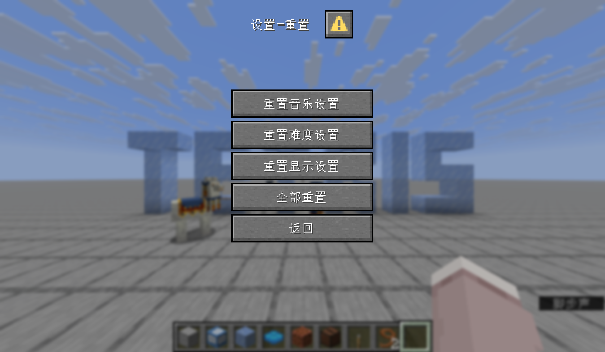

### 基于Minecraft原版数据包与资源包制作的经典2D游戏——俄罗斯方块
## 适用版本
Minecraft **26.3**


## 安装
- 对于资源包，玩家可以选择两种方式，全局安装或者世界指定安装，后者需要玩家将资源包**重命名为`resources`**，**并在存档根目录下创建名为`resourcepacks`的文件夹**，再将资源包放置在该文件夹内。
- 对于数据包，安装在<存档根目录>/datapacks/目录下即可。  


#### 资源包
>**全局资源包**  
>全局资源包需要放置在.minecraft内的resourcepacks文件夹，每个全局资源包都必须是一个子文件夹或一个.zip文件，其他文件格式会被忽略。全局资源包可以被禁用、启用或者调整位置。资源包的显示名称即为该文件夹或.zip文件的名称（含扩展名），可使用格式化代码。

>**世界指定资源包**  
>资源包可以与世界捆绑在一起。将资源包重命名为resources.zip，再将这个文件放入<存档根目录>/resourcepacks中，这个资源包就会成为世界指定资源包。当玩家进入这个世界时，这个资源包将作为最上层资源包被加载，且无法被禁用或调整位置。其名称将显示为“世界指定资源包”。
#### 数据包
>数据包是可被添加到<存档根目录>/datapacks/目录下的文件夹或.zip压缩包。

## 游玩
安装完成后，按**G**键可快捷唤出游戏的主菜单界面，亦可在聊天栏执行命令`/dialog show @s tetris:main_window`，点击**新游戏**开始游玩。
  

此外，游戏画面显示可能并不适应你的屏幕，这十分影响游戏体验，需要**在视频设置中调整分辨率或界面尺寸**。如下图所示，右侧出现滑条，下方按钮显示不完整。  
  


**正常的游戏画面如下所示**  

## 玩法介绍 
#### 方块操控
- 左移、右移、下移按钮位于画面右侧，也就是那三个覆雪冰块。  
- 点击`左移`按钮，方块将向左平移一格  
- 点击`右移`按钮，方块将向右平移一格  
- 点击`下移`按钮，方块将随机加速下落3~5格（含3,5）  
- 点击`旋转`按钮，方块将顺时针旋转90°  
- 点击`硬降落`按钮，方块将直接降落至底部边界或下方方块表面  

#### 下一个方块预览  
- 右下角出现的方块即为下一个降落的方块  

#### 得分机制  
- 消除1行加100分  
- 消除2行加200分  
- 消除3行加300分  
- 消除4行加600分  
- 点击`下移`按钮加1分  
- 点击`硬降落`按钮，游戏将会计算方块下落前后的高度差，以高度差的值为所加分数  

#### 难度机制  
可传送至[游戏设置-难度](#难度)以查看具体难度计算机制

#### 游戏失败判定  
- 方块降落，并在游戏完成行消除判定后，若其最高点高于上边界，则游戏结束  

#### 暂停与结束游戏  
- 点击暂停图标，游戏暂停，图标变化，再次点击，游戏继续  
- 点击结束图标，游戏结束，并跳转至分数结算画面
  

## 游戏设置  
  
点击主菜单界面的**设置**选项，可以进入这个设置界面，目前包含音乐、难度、显示的设置以及它们的重置选项  

#### 音乐  
 


页面较长，这是下面一部分  

循环播放音乐唱片：启用时，开始游戏后会循环播放你从预设曲目中选择的唱片音乐，暂停游戏时会停止播放，点击继续游戏后音乐**不会从此前暂停处继续播放，而是从头开始播放**。  

#### 难度  
  
**游戏的难度取决于方块自然下落的速度，或者说取决于方块下落一格所需要的时间（设为t）。**
难度等级（设为n）只是说明游戏进入了哪个阶段，因为它的值取决于当前游戏的得分位于哪个区间。难度等级每增加1，t的值就按一定比例减小。具体而言，  
```
t = t₀[0.8^(n-1)] = (30-5b)(0.8^n) = (30-5b)[0.8^(⌊s/3000⌋+1)] = (24-4b)(0.8^⌊s/3000⌋)  
```
也就是说，从得分为0时开始，得分每增加3000，难度等级的值增加1，方块下落一格所需要的时间减少到上一个阶段（难度等级）的80%。  
t的单位为游戏刻，结果需要取整，所以难度决定函数的最终表达式为  
```
t = ⌊(24-4b)(0.8^⌊s/3000⌋)⌋
```
其中b为开局难度，s为当前游戏得分（⌊x⌋表示对x向下取整）。  

总之，**难度由当前游戏得分（s）和开局难度（b）共同决定**，其中s与你的游戏表现有关，b在整局游戏中的值是不变的，你可以通过移动设置中的滑条来调整它的值，设置完成后，它将应用于你之后的每一局游戏，当然，你可以随时进行修改。  

### 显示  
  
>游戏规则send_command_feedback控制玩家执行命令的返回信息是否在聊天框中显示，同时影响命令方块是否保存命令输出文本。  

如你所见，这个设置选项本质上是通过修改游戏规则`send_command_feedback`来实现的，由于聊天栏中频繁发送的命令反馈信息可能会影响你的视觉体验，我建议你关闭它，当然，默认的设置就是关闭的。它只在游戏时起作用，游戏结束后会恢复到没开始游戏之前的设置。因此你不必担心关闭它会不会使你的聊天栏和命令方块不再有命令反馈信息。  

### 重置  
  
当你想恢复到默认的设置时，点击相应的按钮即可